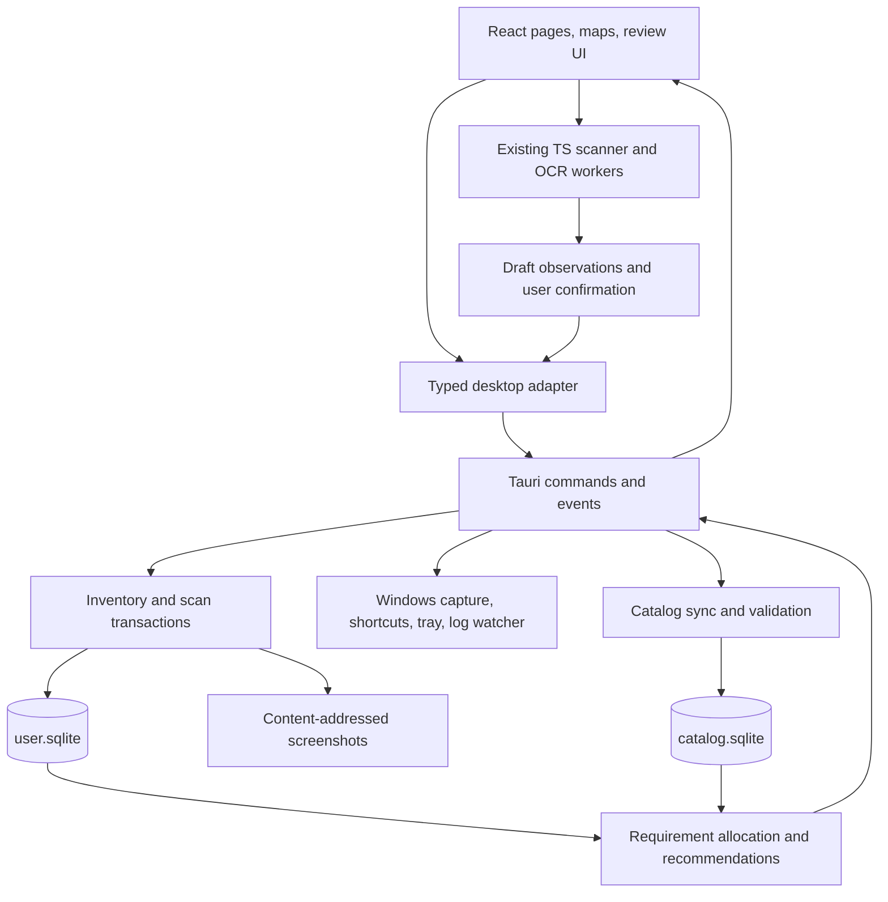

# Tarkov Companion Rust: technical audit and architecture proposal

Date: 2026-10-27 (Europe/Moscow). Inspected revision: `29006730e750cb40ad714da4abd0cdd13e37962c` (upstream release 2.13.0).

Status: proposal for review, not an approved implementation design. Production source, dependencies and installer configuration were not changed. Commands were run against this checkout; the desktop smoke run used an isolated temporary profile. No game-process access, gameplay automation or selling was performed.

## 1. Recommendation

Retain React/TypeScript/Vite and the existing features. Introduce Tauri 2 incrementally behind the existing desktop contract, then make Rust/SQLite the authority for the new physical inventory and scan transactions. Keep the current TypeScript image matcher and Tesseract initially. Port recognition only when a representative benchmark and accuracy corpus justify it.

The project already contains substantial working functionality. The central missing element is a reliable physical inventory model, not a scanner written in Rust. The existing Item Collection is an aggregate checklist, and its current sell hints do not meet the correctness requirements of Intelligent Stash Manager.

Before a packaged fork is launched, isolate its installer, data, update and cleanup identities from the original application. Keep the Electron build as the reference implementation and rollback route until desktop parity is demonstrated.

## 2. Repository and technology inventory

`origin` is `https://github.com/somepoi/tarkov-companion-rust.git`; `upstream` is `https://github.com/David04-09/tarkov-companion.git`. The working tree was clean at the start. There is no Cargo manifest, `src-tauri` directory or existing SQLite layer.

Versions below are the installed lockfile versions, rather than the lower bounds in package.json:

| Area | Current implementation |
| --- | --- |
| Frontend | React/React DOM 19.3.0, TypeScript 6.0.3, Vite 8.3.2, Tailwind 4.3.3 |
| Routing/state/data | React Router 7.18.4, Zustand 5.0.15, TanStack Query 5.104.1 |
| Large lists/maps | TanStack Virtual 3.14.13, Leaflet 1.9.4, React Leaflet 5.0.0, Geoman 2.20.2 |
| Desktop | Electron 44.5.1, electron-builder 26.15.3, electron-updater 6.8.9 |
| Recognition | Custom RGB template matcher, Web Worker, Canvas/OffscreenCanvas, Tesseract.js 7.0.0 |
| Build-time images | sharp 0.35.5; not an in-app native recognition backend |
| Persistence | localStorage/Zustand, IndexedDB/idb-keyval, desktop JSON files |
| Tests/lint | Vitest 5.0.3, oxlint 1.86.0 |
| License declared by project | GPL-3.0-or-later; existing copyright and third-party notices retained |

The distinction between dependencies and devDependencies is packaging-specific: nearly all frontend libraries are bundled by Vite, so their presence in devDependencies does not mean the installed application does not use them.

## 3. How the application actually works

### Startup and desktop interface

1. `index.html` loads `src/main.tsx`. It selects the main app or searchbar from `window.desktop.windowKind`; both use lazy entry imports.
2. `src/App.tsx:17` installs the persisted Query client, desktop bridge and routes. Desktop uses HashRouter; browser builds use BrowserRouter.
3. `src/config/nav.tsx:38` lazy-loads Dashboard, Stats, Events, Quests, Story, Maps, Keys, Ammo, Item Collection, Hideout and Flea Market. Settings is a separate route. There is no current Crafts page, weapon builder or assistant tab; old helper code and preferences remain.
4. `src/components/Layout.tsx:39` mounts shared features: setup/sync review, quest carry-over, story timers, raid briefing/results, position listener, backups and scan-dialog host. The scanner chunk is loaded only when opened (`:127`).
5. `electron/main.ts:71` creates the main BrowserWindow, tray, IPC, shortcuts, updater, log watcher and optional searchbar. `electron/preload.ts` exposes the typed `DesktopApi` from `src/shared/desktop-api.ts:222`.

This desktop interface is the first useful migration seam. It already separates the renderer from Windows filesystem/window operations, although renderer call sites access `window.desktop` directly and will need a small initialization/adapter layer.

The shell has useful protections worth preserving: context isolation, renderer sandbox, no Node integration, IPC sender checks, validated settings/paths, locked navigation and permission denial (`electron/main.ts:245`, `:619`, `electron/security.ts`). Tauri capabilities must preserve these restrictions; merely replacing the shell is insufficient.

### Data loading and cache

`src/api/client.ts:7` uses the static JSON API at `https://json.tarkov.dev`. `catalog.ts` reads `/endpoints`, checks required resources and mode/language availability. `translate.ts` merges base documents with English translation dictionaries. `queries.ts` adapts raw IDs/references into application models; `hooks.ts` manages requests by game mode.

Tasks/traders/maps are grouped by `fetchGameData`; items, hideout, crafts and price history have separate loaders. `barters` exists in the endpoint-name union but has no loader or application model. `fetchJson<T>` checks HTTP and JSON syntax, but its generic cast is not runtime schema validation.

`src/api/persist.ts:18` persists successful non-live queries to IndexedDB. It avoids redundant writes using signatures and a 5-second debounce, flushes on hide/page exit, and excludes price history/status/logStats. Item documents still include cached average prices. Cache maxAge and in-memory gcTime are 30 days. The cache buster includes application version as well as schema; an ordinary app update can discard otherwise useful offline data. Offline availability after update therefore needs a deliberate migration/retained-catalog policy.

Pages are lazy, but Dashboard actually requests the large item document (`DashboardPage.tsx:107`, `useNeeds.ts:12`). The current fetched PvE items response was 17,236,448 decoded JSON bytes, plus a 1,702,635-byte English dictionary. These are payload sizes, not measured RAM or transfer-compressed sizes.

### Player progression and existing features

`src/store/progress.ts:9` stores separate regular/PvE profiles with player level, faction, completed/active/failed quest ID sets. Manual changes, log-derived changes, import/export and persisted-version migration already exist. `src/lib/progression.ts:70` and `useProgressContext.ts:17` infer prerequisite completions and evaluate availability using level, quests and trader context.

`electron/logs/parser.ts`, `tailer.ts`, `watcher.ts` and `locator.ts` detect/read ordinary log files. The renderer bridge (`src/desktop/useDesktop.ts:94`, `:155`, `:234`, `:280`) applies live events, presents historical sync for review and supports undo/history. Reuse this flow. Public catalog endpoints are not a source of the player's personal stash. Automatic level synchronization is not implemented; retain manual level input and the existing XP-based estimate.

`src/store/inventory.ts:7` stores, per mode, `collected`, owned keys, hideout station levels and trader loyalty levels. Favorite craft IDs are shared across modes, but `useNeeds.ts:23` deliberately disables craft requirements after the Crafts tab was removed. `HideoutPage.tsx:72` already supports manual station levels and next-upgrade requirements; it does not store desired target levels or partial construction/material hand-ins.

Maps, story, quest tree, wiki supplements, raid log/statistics, item lookup, ammo, flea prices, keys, drawings, route planning and optional searchbar should remain in the parity checklist. Visibility of wiki quests does not imply machine-readable inventory requirements: wiki-only objectives currently use `type: 'wiki'`, `count: null`, `itemIds: []` (`wikiQuests.ts:364`).

## 4. Screenshot recognition: verified pipeline

| Stage | Verified implementation | Consequence |
| --- | --- | --- |
| Import | `ScanDialog.tsx` accepts paste, drop, file selection and recent game screenshots | Reuse review workflow and import UI |
| Capture | `electron/capture.ts:15` takes PNG of monitor under cursor using desktopCapturer and DPI scale | It does not identify/capture the game window specifically |
| Hotkey | `electron/main.ts:521`, default Alt+Shift+S | Already present; Tauri needs native replacement and conflict diagnostics |
| References | `scripts/build-scan-fingerprints.ts:14` fetches regular/items and grid images, caches images, includes weapon presets and optional correction exports | Build-time source is regular, not verified PvE catalog parity; compare mode IDs/icons |
| Fingerprints | `core.ts:17`, `:30`: area-averaged RGB, 12 pixels per cell side | Small reusable descriptors; not ML embeddings or a neural detector |
| Grid | `core.ts:195`, `:293`, `:366`: edge periodicity, OCR name geometry, candidate pitch/origin scoring/refinement and remembered pitch | One lattice per run; crop one container when multiple grids are visible |
| Candidate retrieval | `core.ts:714`: bucket by dimensions/orientation, precomputed masks/color data | Existing filtering should be benchmarked before replacement |
| Matching | `core.ts:1001`: sample footprints at grid positions; masked mean absolute RGB differences; mean-color rejection, icon/gun comparisons, name bonuses/penalties | Potentially expensive search over cells, footprints and candidates |
| Selection | `core.ts:1211`: greedy non-overlapping detections, footprint bonuses, name anchors, partial bottom-edge items and gun fallback | Segmentation comes from template fitting, not a separate object detector |
| OCR | `ocr.ts:146`: luminance, bicubic upscaling, thresholding, sparse text via offline English Tesseract | Reads printed names; does not implement stack-quantity or FIR extraction |
| Worker | `scanner.ts:37`, `scan.worker.ts:36`: transfer ImageBitmap, OffscreenCanvas, detect/match away from main UI thread | Existing off-thread recognition is worth preserving |
| Review | `ScanDialog.tsx:365`: item alternatives, manual boxes, move/resize/delete, amounts, selection and undo | Good foundation for per-stack confirmation |
| Learning | `learned.ts:79`: IndexedDB records with fingerprint, thumbnail, item, negative/confirmed/corrected kind; bounded retention | Reuse format and export; not a full screenshot/history archive |

### Confidence and uncertainty

`ScanDialog.tsx:65` maps error/margin/name agreement to Sure/Likely/Check. Without name agreement, Sure requires error <12 and margin >=1.5; Likely requires error <18. Name agreement uses a separate threshold. These are heuristic labels, not calibrated probabilities.

Two details require attention before reliable recommendations:

- `buildRows` groups detections by item ID and takes the **minimum** error (`:90`), which can make a mixed-confidence row look stronger than its weakest physical detection. Keep confidence per stack and use conservative aggregation.
- The default selection code (`:220`) can select needed Likely rows as well as Sure rows when preferences permit; the README's stronger wording should not be treated as an executable guarantee.

Unknown occupied regions are not represented as durable unknown inventory stacks. An item not matched by the scanner is not evidence of an empty cell. Add explicit unknown observations and coverage state.

### Quantities, FIR, junk boxes and repeat scans

`Detection` (`core.ts:566`) has identity, cells, dimensions, error and alternatives, but no quantity or FIR field. `buildRows` (`ScanDialog.tsx:83`) increments count by one per detection. The stack warning (`:707`, `:724`) targets ammo/ammoBox; general stackability is not modeled. The matcher deliberately masks bottom overlays containing quantity, durability and FIR marks (`core.ts:94`).

The scanner can process a cropped container grid in principle and the UI explicitly offers that workflow. There is no committed real junk-box corpus, container-type detector, or end-to-end evidence that six specific junk boxes are recognized accurately. Generic grid support is not validation of this use case.

`ScanDialog.tsx:330` applies selected rows to aggregate Item Collection counts. Alternatives may be rewritten to the requirement's first item ID (`:338`), losing physical identity. Add increments counts; Replace only sets selected/present IDs and does not clear absent entries. Neither operation is a complete container-snapshot replacement.

`appliedRef` prevents a double click for the current image in the mounted dialog. It resets on reopening/new image (`:203`), is not durable and does not deduplicate a later import. The UI itself warns that repeated Add scans double-count (`:801`). Undo is one in-memory last-apply record (`scanStore.ts`, `undoApply.ts`), not transactional scan history.

There is no multi-image registration/overlap detection, absolute container coordinate system, durable scan session, history or screenshot archive. There is also no general request cancellation/generation check in `runScan`; older asynchronous results can overwrite a newer image. The worker retains last image pixels and the scanner/OCR workers lack normal idle disposal. These are code-based risks/candidates, not measured regressions.

### Existing scanner tests

`src/scan/core.test.ts` has five synthetic tests covering pitch, placed/rotated items, positive learning, negative learning and confirmation weighting. They do not validate OCR, chooseGrid over real screenshots, stack counts, FIR, junk boxes, capture, stale-result races or repeat-scan semantics. `boxEdit.test.ts` separately covers box editing geometry.

`scan:check` exited successfully with **No corrections to check**. That is an empty corpus, not a recognition-accuracy result. `scan:test` needs generated fingerprints, OCR assets, a screenshot and network item names, writes an annotated image and is not a controlled offline p50/p95 harness.

## 5. Correctness and technical debt

| Priority | Finding and evidence | Required response |
| --- | --- | --- |
| P1 | Fork retains original appId/AUMID, NSIS GUID, product/data names, update owner/repo, installer cache and cleanup patterns (`package.json:68`, `:88`, `:114`; `main.ts:35`, `:483`; `updater.ts:29`, `:73`; `cleanup.ts:16`) | Isolate all namespaces before any packaged fork run/distribution |
| P1 | Lookup/flea/scanner display sell hints without complete requirements or per-instance eligibility (`ItemLookup.tsx:146`, `FleaMarketPage.tsx:188`, `ScanDialog.tsx:504`) | Introduce REVIEW-first safety rules before calling these intelligent recommendations |
| P1 | Repeat Add and partial Replace do not provide container semantics (`ScanDialog.tsx:330`) | Atomic sessions, explicit full/partial scope, idempotent commit |
| P1 | Aggregate counts have no FIR, quantity provenance, physical location or certainty (`store/inventory.ts:7`) | New physical inventory authority; never infer these facts from legacy counts |
| P1 | Partial data can become empty requirements (`useNeeds.ts:21`), unknown FIR becomes false (`needs.ts:68`), alternatives lack global allocation (`needs.ts:66`) | Preserve unknowns, completeness and alternative groups through the planner |
| P1 | npm audit: five vulnerable package entries, four high/one moderate | Review lockfile advisories and update narrowly in a separate verified task; no automatic audit-fix was applied |
| P2 | Import mutates stores sequentially with shallow inventory validation (`progressFile.ts:29`) | Validate all input first, transaction and rollback in new storage |
| P2 — **closed 2026-11-06** | Settings/backups use direct synchronous JSON writes; some errors are swallowed (`settings.ts`, `backups.ts`) | Atomic writes, surfaced errors, recoverable backup manifests. Now: `electron/atomicWrite.ts` (temp file + fsync + rename) and `crate::desktop::atomic_write` (`src-tauri/src/desktop.rs`) cover every JSON write, including the 12 non-user-facing `persistBackgroundSettings()` sites in `electron/main.ts`; backup-retention pruning failures are logged, not thrown. Write failures surface instead of being swallowed: the Rust settings error reaches Settings → Desktop app, and a settings file that cannot be read is refused rather than overwritten, with in-memory state rolled back. A UTF-8 BOM (which Windows Notepad writes) no longer makes valid `settings.json` look corrupt: both readers strip it, and genuine corruption is still refused. |
| P2 — **closed 2026-11-06** | Version-based cache invalidation can remove offline data after upgrade (`persist.ts:86`) | Schema-based migration and retained last-known-good catalog. Now: `src/api/persist.ts` keeps a separate `RETAINED_KEY` copy, preserved at the restoration seam because the upstream persister calls `removeClient()` on both buster mismatch and `maxAge` expiry. Old-schema or expired copies are preserved and disclosed ("cannot be used by this version" / "in use while offline") but never hydrated blindly; a same-schema retained copy is only used when the live slot is empty; the read-only search bar persists nothing; explicit Clear cache removes both keys. |
| P2 | No targeted tests for needs/economy/hideout plan; scanner corpus incomplete | Add tests around actual correctness invariants before extending behavior |
| P2 | No PR/push CI; only tag/manual release workflow | Add ordinary Windows CI before migration |

The audit is not a claim that any identified vulnerability is exploitable in the installed application. `npm audit` includes build/dev tooling; Electron is marked devDependency but is the distributed runtime. Entries were Electron, Vite, fast-uri, http-cache-semantics and undici. See recorded baseline for exact tested versions.

### Why the existing need calculation is insufficient

`src/lib/needs.ts:32` only includes consuming giveItem/plantItem quest objectives, all unbuilt hideout levels and optionally favorite craft inputs. The running hook disables crafts. It has no selected barter plan, user reserves, target hideout horizon, partial hand-in progress, tool protection or physical FIR allocation. `remainingFor` only subtracts total collected.

`useNeeds` uses explicitly completed quest IDs, while other progression views can use inferred completions. Usually this over-reserves, but it is another reason to centralize progression context. Wiki-only item requirements are not normalized. Missing or unrepresentable requirements must be a visible coverage gap, not an implicit assertion that an item is surplus.

The new planner must distinguish an additional item found in a raid from an existing stack already counted in the stash. “Nothing more to collect” does not mean “sell this counted stack.”

## 6. Storage, backup and migration

Current durable data is split across browser localStorage (progress, inventory and other Zustand stores), IndexedDB (Query cache, recognition corrections) and Electron userData (settings, daily backups, update/cleanup notes, content packs). There is no single transaction spanning these stores.

`src/lib/progressFile.ts:13` exports quests, mode inventory, drawings, story and raid log/manual/hidden entries. It does **not** include all preferences, desktop settings, archives/sync history or IndexedDB recognition corrections. Corrections have their own export. Therefore the current daily backup is not a complete application backup. Existing daily JSON backup behavior should remain available during migration.

Proposed storage rules:

1. `user.sqlite` holds authoritative user facts; a separate `catalog.sqlite` holds replaceable versioned catalog snapshots/prices. Avoid cross-database write transactions; user rows reference stable external item IDs and retain minimal labels for offline recovery.
2. Use foreign keys, schema migrations, explicit constraints and one serialized writer. A small `rusqlite` repository on a dedicated blocking worker is sufficient initially; an async connection pool is not justified for this local workload. Exact dependency versions are chosen at implementation time.
3. Profile/mode, containers, snapshots/stacks, scans/observations, corrections, progression/plans/reserves are facts. Recommendations and aggregated counts are derived views keyed by input revisions.
4. Store screenshot blobs outside SQLite by content hash, with metadata/checksum and references in SQLite. Write/flush the blob using `sync_all` or a verified Windows equivalent, rename it into place, then commit references with an explicit SQLite durability policy. This ordering handles ordinary process interruption by leaving recoverable orphans rather than publishing unfinished writes. Filesystem/SQLite power-loss durability must be tested separately; verify referenced files/checksums during recovery and mark missing/corrupt evidence for review. Apply retention only to unreferenced blobs and after an explicit backup policy.
5. Back up SQLite with an online backup mechanism or a coordinated checkpoint/close; copying only the main file while WAL is active is insufficient. Include screenshots/corrections/settings plus manifest, hashes and schema/app versions. Verify restores in an isolated profile.
6. Before legacy import, export every supported store and corrections, validate the entire bundle, record source hash/import version, and import into a new database in one transaction. Record completion only after checks. Repeated import of the same source must be idempotent.
7. Old `collected` represents checklist bookkeeping. Import it as a separately labeled legacy/unlocated estimate with unknown FIR/quantity provenance; do not add it to scanned stacks or turn it into saleable inventory. Ask the user to reconcile each physical container/estimate when scanning replaces those counts.
8. Never directly open or rewrite the original Electron LevelDB/IndexedDB as SQLite. Use export/import (and, if needed, an explicit legacy exporter). Keep source exports and original installation untouched. Rollback restores a known database snapshot and the previous adapter; older binaries must refuse unsupported newer schemas.

### Installation and release isolation

Also change `electron/packs.ts:27`, `:76`: it currently fetches content packs from the original repository's release for the running app version. A fork version is not an upstream content-pack version. Use a fork-owned/pinned manifest with verified hashes and a compatible source.

`main.ts:501` schedules automatic cleanup in packaged builds by default. Current cleanup can recycle old original-named installers from Downloads and service the original updater cache. An isolated userData path alone does not fix this. Disable these actions until all paths/patterns belong to the fork. Likewise preserve opt-in `clearPositionShots`: it can recycle/move game screenshots and must never clean Stash Manager evidence.

`.github/workflows/release.yml` installs Node 22, builds content packs/OCR/maps, runs tests/lint, builds NSIS/portable artifacts, optionally uses SignPath and publishes a tag release. Tauri requires separate updater metadata/signatures; current electron-updater `latest.yml` cannot be reused as a Tauri update manifest. Signing permissions/secrets of upstream must not be assumed available to the fork.

## 7. Current external API verification

The public [endpoint catalog](https://json.tarkov.dev/endpoints) was fetched successfully on 2026-10-27 Moscow time. It advertises regular, pve and pvp-season modes and 19 languages, including en/ru. This app currently supports only regular/pve and English; adding Russian game-text OCR is separate from Russian UI translation.

Context7 was consulted for `/the-hideout/tarkov-api`; its returned material primarily documented GraphQL/Lite API. It does not establish the current JSON wire schema. The JSON catalog and actual responses below were used instead. The local notes' claim that GraphQL is deprecated/down was not independently established and is not needed for this recommendation. Keep the working JSON integration.

| Endpoint | Observed shape / exact relevant fields |
| --- | --- |
| `/pve/items` | `data.items` ID-keyed object; 5,480 entries in this response. `id`, `width`, `height`, `stackMaxSize`, `gridImageLink`, `types`, `avg24hPrice`, `lastLowPrice`, `updated`, `lastScan`, `buyFromTrader`, `sellToTrader` |
| `/pve/items_en` | `data` is translation-key -> English-string dictionary; base name fields can be translation keys |
| `/pve/tasks` | `data.tasks` ID-keyed object; objectives include `type`, `count`, `items` (ID array), `foundInRaid`, `optional`, and condition fields depending on type; task prerequisites/trader/otherRequirements are distinct |
| `/pve/hideout` | `data` is station-ID -> station, not `data.hideoutStations`; `levels[].itemRequirements[]` contains `item`, `count`, `attributes.foundInRaid`; station/skill/trader prerequisites are separate |
| `/pve/crafts` | `data` array, 214 entries in this response; `requiredItems[].item/count/attributes.tool`, `station`, `level`, `duration`, `productItem.item/count` |
| `/pve/barters` | `data` array, 855 entries; `trader`, `taskUnlock`, `requiredItems`, `restockAmount`, `buyLimit`, `minTraderLevel`, `offeredItem` |
| `/pve/traders` | HTTP 200; `data` is trader-ID -> trader, 16 entries; includes `levels`, `resetTime`, `buyAllowed`, `buyProhibited` |
| `/pve/prices/57347c5b245977448d35f6e1` | HTTP 200; `data` array, 1,100 points in this response; exact fields `priceMin`, `price`, `timestamp` (numeric milliseconds in observed point) |
| `/pve/tasks_en`, `/pve/hideout_en` | HTTP 200; `data` translation dictionaries |
| `/pve/maps` | Advertised by catalog and used by existing loader, but the additional live request timed out at 45 seconds; live map response shape was not established in this audit |

Observed trader sale entries contain `trader`, `price`, `priceRUB`, `currency`, `currencyItem`. Do not invent GraphQL fields such as `sellFor` for these JSON documents. One observed barter has a fractional `count` (155.1); do not silently floor malformed/non-integral requirements for countable items. Preserve raw evidence, validate domain meaning and mark unsupported requirements for review.

Request freshness and source freshness are different: one successfully fetched item's `updated` was 2025-12-25, even though the item document's HTTP Last-Modified was current. Preserve fetchedAt, document/sourceUpdatedAt, mode, schema/version and hashes separately. Catalog coverage is not guaranteed by HTTP 200. None of the advertised endpoints is a personal stash endpoint.

The existing fee estimate (`src/lib/economy.ts:34`, `:66`) is useful reference logic, explicitly labeled as an estimate. Keep eligibility/KEEP-SELL decisions independent of market values. Show trader quote, flea estimate, costs, timestamp and unavailable/stale values; never promise proceeds or automatically sell.

## 8. Target architecture and alternatives

| Option | Project-specific benefit | Project-specific cost | Decision |
| --- | --- | --- | --- |
| Tauri 2 + React + Rust | Retains pages/maps/review UI and browser worker scanner; native filesystem/storage/job control | Rebuild desktop shell, WebView2/CSP/OCR compatibility, capture and searchbar behavior | Recommended, gated by a small parity spike and measured baseline |
| Keep Electron; optimize/introduce Rust worker selectively | Smallest immediate change; reference behavior remains available | Retains Electron runtime and bridge/sidecar lifecycle; does not itself solve inventory correctness | Baseline and rollback option; acceptable if Tauri compatibility fails |
| Rust-native GUI such as Slint | Worth exploring if WebView resource floor later proves unacceptable | Current React/Leaflet/HTML story/search/review UI would need substantial replacement and new map integration | Defer; no measured project evidence currently justifies this rewrite |

Tauri uses a core process plus system webview processes; it is not a one-process or browser-free application ([process model](https://v2.tauri.app/concept/process-model/)). Its Windows setup requires Rust, Microsoft C++ tools and WebView2 ([prerequisites](https://v2.tauri.app/start/prerequisites/)). Using an existing runtime can reduce what the installer carries; lower RAM/CPU for this application is still a hypothesis to measure. Slint has a separate declarative/native UI approach ([official overview](https://slint.dev/)); retaining this frontend is the decisive project constraint, not an assumed universal speed ranking.

### Proposed module ownership

- **TypeScript stays:** React views, Leaflet maps, page state, translations/adapters initially, existing progression logic and recognition core. Reuse `useProgressContext`, not a parallel quest system.
- **Rust platform module:** lifecycle, tray/window state, hotkeys, user-approved file import, capture, resource protocol, packs, read-only log events/backfill, settings, backup/update.
- **Rust inventory module:** small interface such as beginScan, saveDraft, commitScan(expectedRevision, idempotencyKey), getInventory and undoCommit. Hide SQL and validation/transaction ordering behind that interface.
- **Rust planner module:** pure input snapshot -> allocations/reasons/recommendations, no network or global preferences. Implement the physical-inventory planner once here; retire old sell hints/derive compatibility views from it. Port prerequisite rules only when their ownership moves, with fixture parity; do not maintain divergent TS/Rust rules.
- **Catalog module:** retain TS loaders during shell migration; later move validated catalog synchronization to Rust as one separate task. Switch ownership explicitly; do not run duplicate sync/cache authorities.
- **Bridge:** preserve current DesktopApi behavior with Electron and Tauri adapters, then add scan-specific versioned DTOs. Use commands for work, events for progress/revision notifications, request IDs, structured errors and unsubscribe. Bind returned results to profile/mode/session/image revision so old results cannot overwrite newer drafts.
- **Security:** least-privilege per-window capabilities, backend checks for every custom command, allowlisted source hosts, resource IDs rather than arbitrary paths. Tauri's [capabilities](https://v2.tauri.app/security/capabilities/) do not eliminate application validation. Test file/blob/WASM workers and CSP under installed WebView2 origins; existing `tcres://`/file assumptions cannot be copied blindly.

SQLite has one authoritative writer; Zustand holds UI state and revision-tagged snapshots. Replace multi-window localStorage write coordination (`crossWindow.ts`) with committed revision events. Do not dual-write `collected` and physical stacks. During transition use a derived compatibility view or keep the legacy checklist explicitly separate until reconciled.

### Jobs and resource control

Use one bounded image job initially, backpressure, cancellation between stages and no unbounded parallelism. Start workers/data on demand. Release last raw pixels/ImageBitmaps and terminate idle OCR/scanner workers after a measured grace period. Move current OCR image preparation (which runs on the renderer before Tesseract) to a worker if profiling confirms UI blocking. Avoid base64 screenshots in generic JSON IPC; persist once and pass resource handles/binary data.

For Rust, do blocking filesystem/SQLite/capture/decompression and CPU work on dedicated blocking workers, never directly in async runtime tasks. Start with a serialized queue; introduce limited parallelism only after profiling.

Use event-based log notifications with debounced bounded reads and a slow fallback/rescan to handle dropped events/rotation. Maintain necessary log tracking while minimized; pause presentation clocks and nonessential rendering. Compute timers from deadlines when visible. Do not promise zero CPU while actively tracking.

## 9. Intelligent Stash Manager design

### User workflow and scope

Add a Stash Manager route while retaining Item Collection until its bookkeeping has a clear migration path. User selects/creates a named container, begins a scan session, imports screenshots, reviews individual observations and commits a snapshot. Container identity is selected by the user; identical-looking junk boxes cannot be reliably identified from screenshots alone.

Show both the combined inventory and per-container locations. Each stack carries quantity and its evidence, FIR `yes/no/unknown`, identity/quantity/FIR confidence separately, cell footprint/rotation, scan time, catalog version and manual confirmation. Preserve unknown objects and partial coverage. A previous observation is not a current verified fact indefinitely; stale/unreconciled stock cannot substitute for confirmed reserves when authorizing sale of another stack.

### Logical schema, not a mandated final DDL

| Entity | Essential data/invariants |
| --- | --- |
| Profile | Stable local ID, mode, level/faction and existing progression; keep PvE/PvP separate |
| Container | Profile, type/name, grid metadata, revision, current snapshot ID |
| ScanSession | Container, base revision, status, full/partial scope, algorithm/catalog versions, timestamps |
| Screenshot | Content hash, dimensions, resource path, capture time; shared blob storage does not imply shared container identity |
| Observation | Screenshot/cell box, candidates, confidence, quantity/FIR evidence, review status, coverage/registration |
| Snapshot/Stack | Immutable committed snapshot facts; stable local stack ID, true item ID or unknown, quantity, FIR and provenance |
| RecognitionCorrection | Existing positive/negative/confirmed references plus schema/version; retain independent export |
| Progress/Plan/Reserve | Reuse quest/hideout facts; add objective hand-ins, desired hideout levels, selected craft/barter batches, extra buffers, never-sell policies |
| Allocation | Requirement -> stack portions with reasons, constraints and input revision; derived/recomputable |
| CachedPrice | Mode/item/source/currency/value/sourceUpdatedAt/fetchedAt; replaceable catalog data |

Use checks for nonnegative valid quantities/revisions, per-profile references and no overlapping committed occupied cells. Image detections are observations; do not persist them immediately as accepted inventory. A row or image hash is not a physical stack identifier.

### Explicit replacement and merge rules

**Full container replacement** is the initial supported mode. Only a user-confirmed full-coverage scan may atomically replace the selected container snapshot. Absent items are removed from that container's current snapshot; other containers remain unchanged. Partial coverage cannot silently become a full replacement. A new scan does not add to the previous snapshot.

**Partial/multiple screenshots** are introduced later. Map each view to absolute grid coordinates using validated alignment; record covered/unknown cells, including partially visible items. Overlap observations of the same physical footprint in one stable layout resolve to one stack. Empty regions may clear stock only when coverage/emptiness is explicitly confirmed. Conflicts, moved items or uncertain offsets require review/new full scan. Never deduplicate by item ID or by identical icon pixels: multiple identical items are legitimate.

**Idempotency and concurrency:** scope the durable idempotency key by profile/container and store the confirmed request/draft hash with the committed result. Inside the serialized transaction, look up this key before checking expectedRevision: the same key and payload returns the previous result even though its original revision is now old; the same key with a different payload is rejected. For a new key, check container expectedRevision, validate the whole draft and write snapshot + stack facts + session status + idempotency record in one transaction. A duplicate image hash prompts comparison within the container/session, but cannot suppress a legitimately identical screenshot of a different box. A genuinely new stale-revision request gets a reviewable conflict. Undo restores a previous snapshot only if no intervening commit has superseded it, or opens a reconciliation flow.

This prevents application duplicate counting. It cannot infer an unrecorded physical transfer between boxes scanned at different times. Show per-container timestamps and a batch scanning/reconciliation workflow; if a player moves items between captured views, request a rescan instead of claiming a globally simultaneous stash.

### Recommendation model and conservative allocation

Keep quantity reservation separate from pricing. Every result includes explanation, input revisions, scope and coverage limitations. Overall item rows can show KEEP 13 / SELL 12 / REVIEW 2; each portion links to physical locations.

1. Normalize uncompleted relevant quest objectives, planned hideout upgrades (with dependency closure), selected craft/barter batch inputs and user buffers. Preserve objective IDs, partial hand-ins, FIR/state constraints, alternatives and provenance. Inferred quest completions remain distinguishable from explicit confirmations.
2. Define plan horizon explicitly: all known future consuming quests by default, selected hideout targets, selected recurring craft/barter batches. Unknown story/branch/wiki requirements remain coverage gaps; mutual exclusions require verified branch logic, otherwise conservative retention/review.
3. Consumed requirements **sum**, even when quests/upgrades are performed sequentially: the same bolt cannot be handed in twice. Reusable tools use the maximum needed concurrently, not the sum across sequential recipes. Do not assume an input is reusable unless data says so. Keep extra buffers distinct from a minimum-total floor: `reserve = max(consumed + reusable + extraBuffer, minimumTotal)` for the simple single-item case. The illustrative 25 owned, 8 consumed and 5 extra buffer yields 12 surplus.
4. Allocate globally across actual stacks. A stack portion cannot satisfy two consuming requirements. Use a deterministic integral allocation/matching algorithm for alternative item sets and constraints; naive per-item subtraction or a greedy first alternative can fail when a scarce item also has an exclusive requirement. Retain explanations and unsatisfied quantities.
5. Assign FIR-confirmed stock to FIR needs; use confirmed non-FIR for unconstrained consumption where possible. Unknown FIR does not satisfy a FIR-specific requirement. It must not be discarded as surplus while unresolved FIR demand could make it valuable. Unsupported condition/quantity/FIR evidence returns REVIEW for the affected decision.
6. Never-sell/favorites protect all applicable stacks regardless of price. Uncertain identity/quantity, unresolved overlap, stale inventory supplying a needed reserve, incomplete required catalog sources or unreconciled legacy counts prevent a positive SELL for the affected allocation.
7. SELL is only a known, confirmed, unallocated surplus portion **after** reservation. All other uncertainty yields REVIEW; price staleness separately disables trusted revenue/best-venue estimates and is explained. Unknown prices alone do not prove an item is needed or unnecessary.

For trustworthy sale recommendations, represent every relevant item requirement in the declared horizon or visibly mark the scope incomplete. In particular, a wiki task rendered as free text must not silently vanish from the coverage calculation. Manual protected reserves provide a safe interim fallback; they are not evidence that the missing catalog requirement has been parsed.

### Required correctness scenarios

- Two boxes with 10 and 15 of item A aggregate to 25 and retain locations.
- Reimport/recommit/restart does not add duplicate inventory; a changed full scan removes absent stacks only from that box.
- Identical items in distinct cells and identical screenshots of distinct containers remain distinct inventory.
- Scrolled overlap at known offset counts a footprint once; unknown offset/changed layout never merges automatically.
- Unknown quantity/FIR/identity and partially clipped items remain reviewable, never silently saleable.
- FIR/non-FIR mixed stock, competing alternatives, consuming vs reusable inputs, partial hand-ins, completed quests, branch uncertainty, reserves and never-sell policies are tested.
- Crash before/during/after commit, disk-full, stale concurrent window and interrupted migration recover without partial totals.
- Moving an item between non-simultaneous box scans is explicitly reconciled, not guessed from screenshots.

## 10. Performance evidence and remaining baseline work

Host: Windows 10 Enterprise build 19045, Ryzen 7 7800X3D (8 cores/16 logical), approximately 31.6 GiB addressable physical memory reported by Windows, NVIDIA RTX 5080. Shell Node 24.15.0/npm 12.0.2 differs from release workflow Node 22. Rust/cargo commands were unavailable in PATH; C++ toolchain/WebView2 development readiness was not established.

| Check/measurement | Observed result | Interpretation |
| --- | --- | --- |
| `npm ci` | Success, 416 packages added; deprecation notices; Tesseract donation postinstall blocked | Electron binary required explicit `node node_modules/electron/install.js`, which succeeded |
| `npm test` | 29 files, 186 tests passed; Vitest duration 701 ms | Unit baseline only |
| `npm run lint` | Exit 0, no findings | Existing lint baseline |
| `npm run build:desktop` | Exit 0; typecheck + renderer/main/preload outputs | Not a packaged installer or native parity validation |
| `npm run build` | Exit 0 | Web build also works |
| `npm audit --json` | Exit 1; 5 vulnerable package entries (4 high, 1 moderate) | Requires scoped follow-up |
| `npm run scan:check` | Exit 0, zero corrections | No accuracy evidence |
| Isolated hidden desktop startup | 524.8 ms from requiring built main to detecting React main | One instrumented unpackaged run; not OS launch-to-visible-paint |
| Hidden memory over 20 one-second samples | Mean private bytes 299.4 MiB; aggregate working sets 423.4 MiB | All processes reported by app.getAppMetrics; working sets may double-count shared pages |
| Hidden CPU samples | Mean sum 0.00888%, max 0.02608% in Electron's reported units | Primed API, watcher paused and UI hidden; not gameplay CPU or portable Task Manager comparison |
| Peak memory, GPU utilization, scan/OCR latency, UI latency, p50/p95 | Not established | No representative screenshots/generated assets in checkout; no active-game run |

Raw samples and harness are in `docs/audit/2026-10-27/`. The harness redirected userData and game paths, suppressed login-item writes, paused watcher and disabled tracking/hotkeys/searchbar/updater/cleanup. First-run UI remained open over the dashboard; network settling/cache state was not controlled. The measured run is a smoke measurement only. Do not use it to claim a performance win or a complete original-app baseline. [Electron metrics](https://www.electronjs.org/docs/latest/api/app#appgetappmetrics) and [memory units](https://www.electronjs.org/docs/latest/api/structures/memory-info) define the fields.

### Candidates established from code, not profiled bottlenecks

- Watcher polls every 750 ms and rescans every 3 s (`watcher.ts:16`); timer remains allocated while paused/no-folder. Tail reads are synchronous and unbounded by chunk size (`tailer.ts:29`). Historical backfill yields between folders, not inside all file parsing (`watcher.ts:268`).
- Pack download buffers chunks then concatenates and unpacks synchronously (`packs.ts:81`); potential transient copies and main-thread stalls.
- Resize/move saves settings synchronously on every event (`main.ts:276`).
- OCR preprocessing allocates large float arrays/Canvas images on the renderer (`ocr.ts`); matcher grid/footprint search and repeated sampling are candidate CPU costs. Current worker timing excludes OCR, init/download, createImageBitmap and most end-to-end UI work.
- Scanner and Tesseract retain workers; scanner retains last RGBA image. Huge imports lack a clear dimension/memory budget and cancellation path.
- Long Query retention and loading both modes can retain sizable catalogs. Lazy page loading, worker matching, color filtering, virtualized flea list and debounced IndexedDB persistence are already good decisions.
- Presentation timers include 1-second raid/trader clocks and 30-second story/status clocks. Query background behavior must be measured; absence of explicit visibility handling is not proof that every network interval runs while hidden.

### Comparable benchmark protocol

Before optimizing, pin commit/dependency versions, CPU/power plan, resolution/DPI, WebView2 version, dataset hashes and app settings. Compare Electron and Tauri **release** builds with the same copied profile/catalog/assets and no competing test workload. Count all descendant processes, including GPU/utility/WebView2 and any sidecar. Report private bytes and aggregate working set separately.

Measure at least: cold/warm startup over 10 launches; Dashboard/Maps/searchbar visible and minimized idle for 5 minutes after settling; watcher enabled with identical synthetic log replay and no-change logs; actual game-running impact separately; OCR/matcher/end-to-end stages and sampled memory peaks over at least 100 scans on a stratified corpus (multiple resolutions/DPI, dense junk boxes, stacks, cropped/scrolled/overlap/ambiguous cases). Separate cold worker/data initialization from warm scans. Use nearest-rank p50/p95 with sample count, input-size strata and failures reported, not discarded. Compare labeled identities/quantities/geometry and high-confidence false matches as well as latency. Measure event-loop long tasks/input latency and GPU engine utilization where available; record unavailable counters explicitly. Establish numerical product budgets only after these observations.

## 11. Migration gates, safety and release policy

The detailed prioritized roadmap and exact first task are in `docs/plans/2026-10-27-migration-plan.md`. The order is: fork isolation and safety baseline, representative corpus, desktop adapter/Tauri parity, authoritative inventory/storage, single-container verified scanning, conservative planner, partial/overlap scanning and measured optimization, then assisted workflows/releases.

Target Windows 10/11 explicitly; the smoke run demonstrates only this Windows 10 host, not the compatibility matrix. Validate current supported WebView2/Rust/plugin versions, offline runtime bootstrap and mixed DPI. [Tauri installer options](https://v2.tauri.app/distribute/windows-installer/) include online/offline runtime provisioning. [Tauri updater](https://v2.tauri.app/plugin/updater/) requires artifact verification signatures; this is distinct from Windows executable code signing.

Preserve GPL-3.0-or-later notices and third-party attribution. `THIRD_PARTY_NOTICES.txt` records distinct terms for map imagery, wiki content, Tesseract and game images; keep those distinctions and verify redistribution rights when producing fork packs. Merely placing assets in a separate download does not establish permission. This audit does not certify licensing compliance or Battlestate approval.

Ordinary screenshots/read-only logs avoid the invasive mechanisms excluded by the requirements. They are not proof of anti-cheat permission. The README's claim that the game cannot tell the app is running is not technically established. Document policy uncertainty honestly; keep capture user-triggered, never access game process memory, inject, intercept game traffic, send gameplay input, bypass protection or implement automatic selling.

No commits, pushes, tags or release publication were performed. Future commits must use the existing Git user.name/user.email without AI author/coauthor trailers, as requested.
